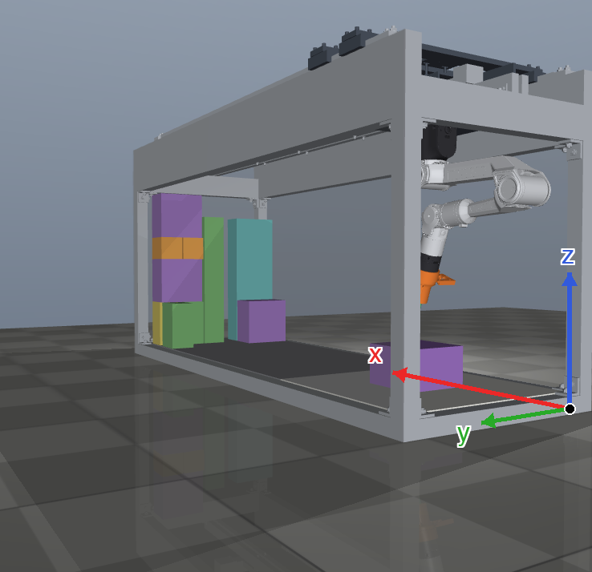

### 프레임 사이즈

- 프레임 기둥·가로대 (바닥 레일, 세로 기둥, 상단 레일): [modules/arm/model/manibox_modified.xml:70-149](../../modules/arm/model/manibox_modified.xml#L70-L149)
- 바닥판 (board_1~3): [modules/arm/model/manibox_modified.xml:154-156](../../modules/arm/model/manibox_modified.xml#L154-L156)
- 벽 패널 (wall_front, wall_back, wall_end): [modules/arm/model/manibox_modified.xml:159-161](../../modules/arm/model/manibox_modified.xml#L159-L161)
- 바닥판 윗면 z 상수: [modules/arm/stacking.py:32](../../modules/arm/stacking.py#L32) (`FLOOR = 0.043`)
- 공구 끝 최고 높이: [modules/arm/stacking.py:44](../../modules/arm/stacking.py#L44) (`MV_CUP_POS = 0.47`)

### 박스 사이즈

종류는 5가지, 각 종류를 **10개씩** 만든다 (총 50개).

| 새 번호 | 크기 L×W×H (mm) | 만드는 법 | 부피 | 총 개수 |
|---|---|---|---|---|
| 1 | 80 × 80 × 100 | 2번 * 1개 | 0.64 L | 10개 |
| 2 | 160 × 80 × 80 | 1번 * 2개 | 1.02 L | 10개 |
| 3 | 160 × 80 × 100 | 2번 * 2개 | 1.28 L | 10개 |
| 4 | 160 × 160 × 80 | 1번 * 4개 (새로) | 2.05 L | 10개 |
| 5 | 160 × 160 × 100 | 2번 * 4개 | 2.56 L | 10개 |

- 기본 상자 6종 (sim_final 기준): [modules/arm/stacking.py:34](../../modules/arm/stacking.py#L34) (`BOXES`)
- 더한 상자 (종류 7, 160×160×80): [modules/arm/rules.py:12](../../modules/arm/rules.py#L12) (`EXTRA_BOXES`)

### 레일 구동 범위 위치

- 레일 슬라이드 조인트 범위 (−0.49 ~ +0.51 m): [modules/arm/model/manibox_modified.xml:165](../../modules/arm/model/manibox_modified.xml#L165)
- 레일 액추에이터 제어 범위: [modules/arm/model/manibox_modified.xml:240](../../modules/arm/model/manibox_modified.xml#L240)
- 레일 0 일 때 팔 베이스의 월드 좌표: [modules/arm/stacking.py:31](../../modules/arm/stacking.py#L31) (`ORIGIN = (0.700, 0.280, 0.672)`)

### 투입 위치 + 투입 공간 크기 + 창고 크기

- 투입 위치 (월드 x, y) = (0.29, 0.28): [modules/arm/stacking.py:37](../../modules/arm/stacking.py#L37) (`PICK_XY`)
- 투입 공간(= 투입 구역) 경계 x < 0.70 m: [modules/arm/rules.py:9](../../modules/arm/rules.py#L9) (`KEEPOUT_X`)
- 창고 크기 — 아직 정의한 곳이 없다. 추가하려면 [modules/arm/model/manibox_modified.xml](../../modules/arm/model/manibox_modified.xml) 에 geom 을 더하고 [modules/arm/rules.py](../../modules/arm/rules.py) 에 경계값을 상수로 둔다.

### 카메라 위치

- 시뮬 뷰용 고정 카메라 3종 (view, overview, front): [modules/arm/model/manibox_modified.xml:65-67](../../modules/arm/model/manibox_modified.xml#L65-L67)
- 공구에 달린 손목 카메라 (wrist, ArUco 측정용): [modules/arm/model/manibox_modified.xml:219](../../modules/arm/model/manibox_modified.xml#L219)

### 좌표계

- 설명 (월드·로봇 좌표, 축 방향): [pipeline/details_by_modules/mp.md:97-101](../details_by_modules/mp.md#L97-L101)
- 로봇 좌표계 원점 상수: [modules/arm/stacking.py:31](../../modules/arm/stacking.py#L31) (`ORIGIN`)

